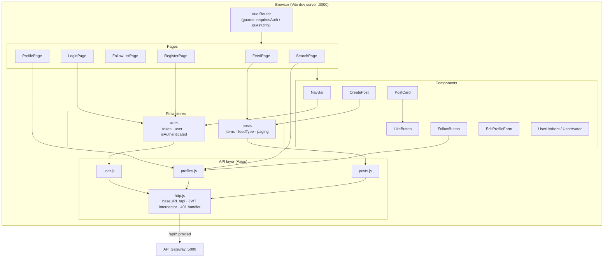
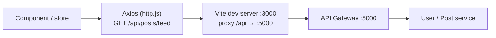
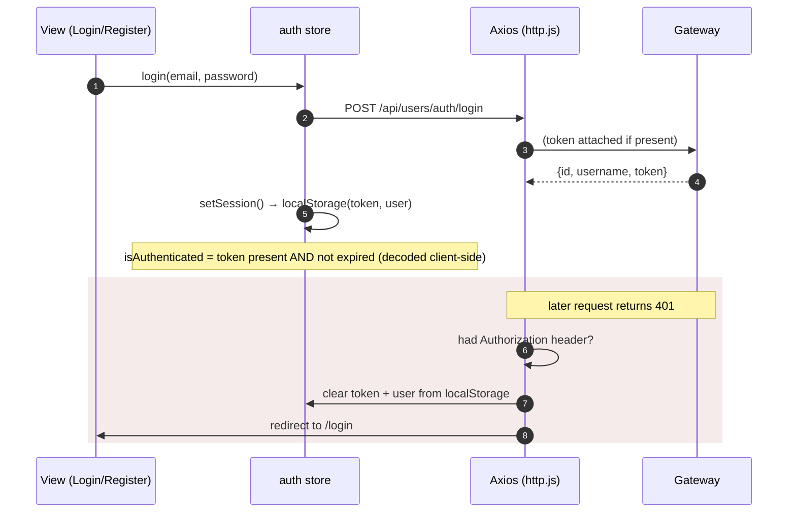
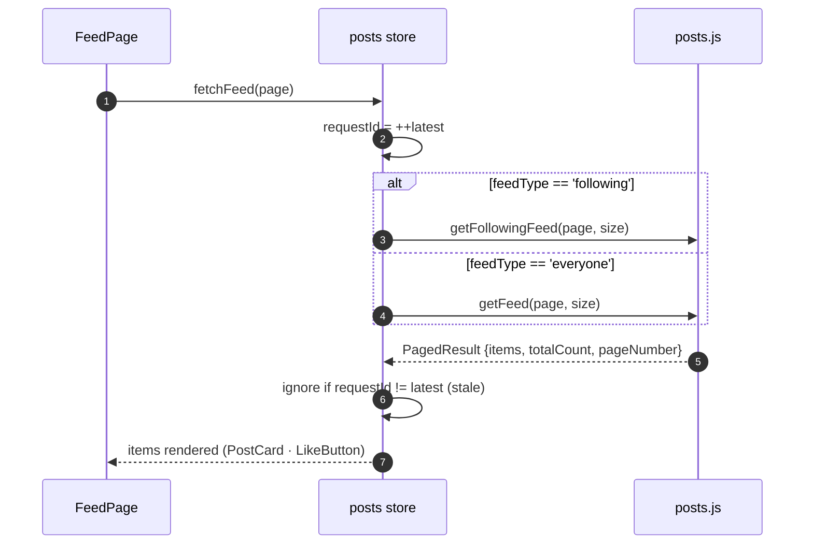

# SocialPlatform – Frontend

A single-page app for the SocialPlatform social network, built with **Vue 3** (`<script setup>` SFCs), **Vite**, **Pinia**, **Vue Router**, **Tailwind CSS**, and **Axios**. It talks to the backend only through the API gateway.

## Overview

- **Auth** is JWT-based. The token lives in `localStorage`; an Axios interceptor attaches it to every request and clears the session on a `401`.
- **State** is held in two Pinia stores: `auth` (session) and `posts` (feed).
- **Routing** is client-side with guards that redirect unauthenticated users to `/login` and logged-in users away from guest-only pages.
- In development, Vite serves the app on port **3000** and proxies `/api/*` to the gateway on port **5000**, so there are no CORS issues and no hardcoded backend host.

## How the pieces fit



## Request path (dev)

Every call goes browser → Vite proxy → gateway → service. Nothing in the frontend knows a service's real port.



## Auth flow

`http.js` adds the bearer token to outgoing requests and, on a `401` to an authenticated request, wipes the session and bounces to `/login`. Route guards keep protected pages from rendering without a valid, unexpired token.



## Feed data flow

The `posts` store supports two feeds — **Following** and **Everyone** — and guards against out-of-order responses with a request-id check, so the latest fetch always wins.



> Switching tabs (`setFeedType`) clears the current items and resets paging before the next fetch. `createPost` posts then re-fetches page 1, since your own posts appear in both feeds.

## Project structure

```
frontend/
├── index.html
├── vite.config.js          # dev server :3000, proxy /api → :5000
├── src/
│   ├── main.js             # app bootstrap: Pinia + Router
│   ├── App.vue
│   ├── style.css           # Tailwind entry
│   ├── router/
│   │   └── index.js        # routes + auth guards
│   ├── stores/
│   │   ├── auth.js         # session: token, user, login/register/logout
│   │   └── posts.js        # feed: items, feedType, paging
│   ├── api/
│   │   ├── http.js         # Axios instance, JWT interceptor, 401 handler
│   │   ├── user.js         # auth endpoints
│   │   ├── profiles.js     # profile / follow / search endpoints
│   │   └── posts.js        # post / feed / like endpoints
│   ├── pages/
│   │   ├── FeedPage.vue
│   │   ├── ProfilePage.vue
│   │   ├── FollowListPage.vue
│   │   ├── SearchPage.vue
│   │   ├── LoginPage.vue
│   │   ├── RegisterPage.vue
│   │   └── NotFoundPage.vue
│   ├── components/
│   │   ├── NavBar.vue
│   │   ├── CreatePost.vue
│   │   ├── PostCard.vue
│   │   ├── LikeButton.vue
│   │   ├── FollowButton.vue
│   │   ├── EditProfileForm.vue
│   │   ├── UserListItem.vue
│   │   └── UserAvatar.vue
│   └── utils/
│       ├── jwt.js          # decode token, check expiry
│       └── errors.js
```

## Routes

| Path | Name | Access | Page |
|---|---|---|---|
| `/` | `feed` | authenticated | FeedPage |
| `/search` | `search` | authenticated | SearchPage |
| `/profile/:id` | `profile` | authenticated | ProfilePage |
| `/profile/:id/:kind(followers\|following)` | `follow-list` | authenticated | FollowListPage |
| `/login` | `login` | guests only | LoginPage |
| `/register` | `register` | guests only | RegisterPage |
| `/:pathMatch(.*)*` | `not-found` | any | NotFoundPage |

## Getting started

Requires **Node.js 18+** and the [backend](../backend/README.md) running (at least the gateway and the User & Post services).

```bash
npm install
npm run dev        # http://localhost:3000
```

The dev server proxies `/api` to `http://localhost:5000`. If your gateway runs elsewhere, change the proxy target in [vite.config.js](vite.config.js).

### Scripts

| Command | Description |
|---|---|
| `npm run dev` | Start the Vite dev server with hot reload |
| `npm run build` | Production build to `dist/` |
| `npm run preview` | Serve the production build locally |

> A production build has no dev proxy — serve `dist/` behind a reverse proxy that forwards `/api` to the gateway, or set up equivalent routing.

## Tech stack

- Vue 3 (`<script setup>` SFCs) + Vite
- Pinia (state), Vue Router (routing)
- Axios (HTTP) with a JWT request interceptor
- Tailwind CSS (via `@tailwindcss/vite`)
